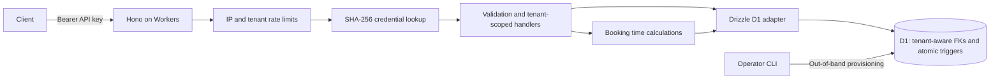

# BookingHub API

[](https://github.com/yunusgok/bookinghub-api/actions/workflows/ci.yml)
[](LICENSE)

**Tenant-isolated booking management built with TypeScript, Cloudflare Workers and D1.**

A TypeScript REST API for appointment-based businesses: consultants, yoga studios and personal trainers. Each business manages customers, services and bookings using its own revocable API keys. A shared D1 database enforces tenant ownership and prevents overlapping appointments atomically.

This is a backend portfolio project with local runtime verification. It has not been deployed or assessed under production load. An interactive Swagger UI is included for API exploration; there is no customer-facing frontend or public administrative API.

## Contents

- [Problem and design goals](#problem-and-design-goals)
- [Features](#features)
- [Stack and architecture](#stack-and-architecture)
- [Run locally](#run-locally)
- [Authentication and rotation](#authentication-and-rotation)
- [API and Swagger UI](#api-and-swagger-ui)
- [End-to-end example](#end-to-end-example)
- [Booking correctness](#booking-correctness)
- [Database and repository structure](#database-and-repository-structure)
- [Tests and checks](#tests-and-checks)
- [Command reference](#command-reference)
- [Migrations](#migrations)
- [Deployment](#deployment-manual-not-performed)
- [Security and limitations](#security-and-limitations)
- [Roadmap](#roadmap)
- [Troubleshooting](#troubleshooting)
- [Contributing](#contributing)

## Problem and design goals

Small appointment-based businesses need a way to maintain customer records, define services and reserve time without accidentally accepting conflicting bookings. A shared API must also keep each business's data isolated, including when someone guesses another business's resource IDs.

BookingHub focuses on these backend boundaries: authenticated tenant identity, relational integrity, atomic scheduling rules, repeatable migrations and tests that exercise the real Workers runtime. V1 intentionally models one bookable resource per business. It demonstrates a complete backend workflow without introducing payments, notifications or multi-resource scheduling.

## Features

- Tenant identity derived exclusively from hashed Bearer credentials; tenant-aware queries and composite foreign keys.
- Customer CRUD with soft deletion, unique email per tenant and paginated lists.
- Service CRUD with 1–1440 minute durations and deactivation.
- UTC bookings with calculated end times, filters, cancellation and database-enforced conflict prevention.
- Request IDs, consistent errors, 16 KiB request limits, IP/tenant rate limits and metadata-only logs.
- Machine-readable OpenAPI, Workers/D1 integration tests and GitHub Actions validation.

## Stack and architecture

Strict TypeScript, Cloudflare Workers, Hono, D1/SQLite, Drizzle ORM and migrations, Zod 4, Vitest with Cloudflare's Workers plugin, npm, ESLint and Prettier. The lockfile records the compatible versions actually tested; see [platform decisions](docs/decisions/0001-d1-atomic-bookings.md).



See [architecture](docs/architecture.md) for the schema, consistency boundaries and data policies.

## Run locally

Use Node.js **24 LTS** and npm. The project requires Node >=24; initial development verification was on Node 25.2.0. Workers tests require a platform supported by workerd (macOS/Linux; use WSL on Windows). No Cloudflare login or production secrets are needed locally.

```sh
git clone https://github.com/yunusgok/bookinghub-api.git
cd bookinghub-api
nvm use # optional, if nvm is installed
npm ci
cp .dev.vars.example .dev.vars
npm run db:migrate
npm run admin -- bootstrap "Demo Studio"
# Copy the printed tenant UUID; the key is displayed only once.
npm run admin -- seed <tenant-uuid>
npm run dev
```

Wrangler serves at `http://localhost:8787`. Keep the terminal containing the one-time key private. Store it in a password manager, and avoid shell history, command logs and source files. The seed command creates synthetic customer/service data with `example.com` addresses; it can be run repeatedly with fresh IDs.

```sh
curl http://localhost:8787/health
# In bash/zsh, read the key without putting its value in shell history:
read -r -s API_KEY
export API_KEY
curl -H "Authorization: Bearer $API_KEY" http://localhost:8787/v1/customers
```

The initial D1 ID in `wrangler.jsonc` is a local placeholder. Local state is in the ignored `.wrangler/` directory. Tests use separate ephemeral databases and never this local development database.

## Authentication and rotation

Keys contain 32 random bytes generated by Web Crypto. Only SHA-256 digests are stored; key IDs are nonsecret administrative identifiers. There are no unauthenticated tenant/key creation endpoints.

```sh
npm run admin -- issue-key <tenant-uuid>
# Configure clients with the new key and verify them before revoking the old key.
npm run admin -- revoke-key <old-key-uuid>
```

The CLI defaults to local D1. `--remote` is an explicit operator choice for a configured deployment. Seed is always local-only. Revocation takes effect on subsequent authentication lookups; requests already authenticated may finish. See [SECURITY.md](SECURITY.md).

## API and Swagger UI

Read [examples](docs/api-examples.md) or import [OpenAPI JSON](docs/openapi.json) into an API client. Open [Swagger UI](http://localhost:8787/docs) at `/docs` to browse endpoints and send requests. Click **Authorize**, enter your `bh_...` API key without the `Bearer` prefix, then use **Try it out** and **Execute**. Authorization stays in memory and is cleared on reload. Swagger UI loads pinned 5.35.1 assets from jsDelivr, so the GUI requires internet access. API calls use the current server origin. The running API exposes the same specification at `/openapi.json`; regenerate the checked-in copy with `npm run openapi`.

| Method               | Path                      | Behavior                                  |
| -------------------- | ------------------------- | ----------------------------------------- |
| GET                  | `/health`                 | Public process health (does not query D1) |
| GET                  | `/docs`                   | Public interactive Swagger UI             |
| GET                  | `/openapi.json`           | Public OpenAPI 3.1 specification          |
| POST / GET           | `/v1/customers`           | Create / list customers                   |
| GET / PATCH / DELETE | `/v1/customers/:id`       | Retrieve / update / deactivate            |
| POST / GET           | `/v1/services`            | Create / list services                    |
| GET / PATCH / DELETE | `/v1/services/:id`        | Retrieve / update / deactivate            |
| POST / GET           | `/v1/bookings`            | Create / list bookings                    |
| GET                  | `/v1/bookings/:id`        | Retrieve booking                          |
| POST                 | `/v1/bookings/:id/cancel` | Idempotent cancellation                   |

All `/v1` operations require `Authorization: Bearer <key>`. Unknown fields are rejected. Create/update bodies use `application/json`. Timestamps require real UTC dates with exactly three fractional digits, such as `2027-01-15T10:00:00.000Z`. End times are immutable snapshots of the service duration read at creation; duration changes affect future creations. Past bookings are permitted in v1.

Successful bodies use `{ "data": ... }`. Lists add `{ "pagination": { "limit": 20, "offset": 0, "hasMore": false } }`; supply `limit` (1–100) and `offset` (0–100000). Ordering is ascending `(createdAt, id)`. Offset pagination can shift during concurrent writes. Inactive customers/services remain visible. Booking filters: `status`, `customerId`, `serviceId`, `from` (start inclusive), `to` (start exclusive). Unknown query parameters return 422.

Errors use `{ "error": { "code": "booking_conflict", "message": "The time slot is unavailable.", "requestId": "..." } }`. Every response has a server-generated `X-Request-ID`; supplied IDs are not trusted. HTTP statuses: 200 retrieval/update, 201 creation, 204 deactivation, 400 malformed JSON/content type, 401 invalid credentials, 404 missing/foreign resource, 409 conflict/duplicate/inactive reference, 413 oversized body, 422 invalid input, 429 throttled (with `Retry-After: 60`), 500 generic internal error. No stack traces are returned.

## End-to-end example

After bootstrapping a tenant, read its API key into `$API_KEY` as shown above. The following commands use `jq` to extract returned IDs; alternatively, copy the IDs from Swagger UI. All customer values below are synthetic.

```sh
BASE_URL=http://localhost:8787

CUSTOMER_ID=$(curl --fail-with-body -sS "$BASE_URL/v1/customers" \
  -H "Authorization: Bearer $API_KEY" \
  -H 'Content-Type: application/json' \
  -d '{"name":"Demo Customer","email":"walkthrough@example.com"}' | jq -r '.data.id')

SERVICE_ID=$(curl --fail-with-body -sS "$BASE_URL/v1/services" \
  -H "Authorization: Bearer $API_KEY" \
  -H 'Content-Type: application/json' \
  -d '{"name":"Consultation","description":"Introductory session","durationMinutes":30}' | jq -r '.data.id')

BOOKING_ID=$(curl --fail-with-body -sS "$BASE_URL/v1/bookings" \
  -H "Authorization: Bearer $API_KEY" \
  -H 'Content-Type: application/json' \
  -d "$(jq -n --arg customerId "$CUSTOMER_ID" --arg serviceId "$SERVICE_ID" \
    '{customerId:$customerId, serviceId:$serviceId, startAt:"2027-01-15T10:00:00.000Z"}')" | jq -r '.data.id')

curl --fail-with-body -sS "$BASE_URL/v1/bookings/$BOOKING_ID" \
  -H "Authorization: Bearer $API_KEY"

curl --fail-with-body -sS -X POST "$BASE_URL/v1/bookings/$BOOKING_ID/cancel" \
  -H "Authorization: Bearer $API_KEY"
```

The booking starts at 10:00 UTC and ends at 10:30 UTC. While it is active, another booking overlapping that interval receives HTTP 409. A booking starting exactly at 10:30 is allowed. Cancellation keeps the historical row and frees the interval for a new booking. Repeating the customer creation with the same email produces 409 because email is unique per tenant.

A conflict response has this shape:

```json
{
  "error": {
    "code": "booking_conflict",
    "message": "The time slot is unavailable.",
    "requestId": "67dc6ab6-4ed4-43f6-a988-67fe49ec1bdf"
  }
}
```

## Booking correctness

The database owns the scheduling invariant. `BEFORE INSERT` and `BEFORE UPDATE` triggers reject an active booking when another active booking for the same tenant satisfies:

```text
newStart < existingEnd AND newEnd > existingStart
```

The overlap check runs inside the write statement, eliminating the gap between a separate application-level availability check and insertion. A Worker-local mutex would not protect requests handled by other isolates. Tenant-aware foreign keys independently require the booking's customer and service to belong to its tenant. Trigger checks also reject inactive parents at write time.

This behavior is tested against actual local D1, including twelve overlapping API requests, eight concurrent direct database writes, update reactivation and transactional rollback. Read the [design decision and platform references](docs/decisions/0001-d1-atomic-bookings.md) for the reasoning and limits of this evidence. These checks do not represent a production load benchmark.

## Database and repository structure

| Table       | Purpose and important constraints                                                                         |
| ----------- | --------------------------------------------------------------------------------------------------------- |
| `tenants`   | Business identity and creation timestamp                                                                  |
| `api_keys`  | Unique credential digest, tenant reference and optional revocation timestamp                              |
| `customers` | Tenant ownership, unique email per tenant, deactivation and timestamps                                    |
| `services`  | Tenant ownership, active flag and bounded duration                                                        |
| `bookings`  | Composite tenant/customer and tenant/service foreign keys, immutable interval and active/cancelled status |

Indexes support credential lookup, tenant-scoped pagination and overlap detection. The project stores canonical UTC timestamps; booking end time is a duration snapshot rather than a dynamic join to the current service duration.

```text
.github/workflows/       Pull request and push validation
src/
  app.ts, index.ts       Hono composition and Worker entry point
  db/                   Typed Drizzle schema
  lib/                  HTTP parsing, errors, cryptography and environment types
  middleware/           API-key authentication and tenant rate limiting
  repositories/         D1 adapter and credential lookup
  routes/               Customer, service and booking endpoints
  schemas/              Strict Zod request validation
  services/             Booking domain calculations
  openapi.ts            Machine-readable API contract
migrations/             SQL schema, booking guards and Drizzle snapshots
scripts/                Bootstrap, key management, seed, smoke test and spec export
tests/
  unit/                 Validation and domain rules
  integration/          CRUD, auth, isolation and HTTP errors
  concurrency/          Concurrent booking writes and rollback behavior
docs/                   Architecture, examples, decisions and verification evidence
```

## Tests and checks

```sh
npm run check
npm run test:watch
npm run openapi
npm run db:generate  # no diff expected unless schema changed
npm run smoke:local # after local migrations; creates synthetic data, revokes its keys
```

Unit tests validate boundaries and date/overlap calculations. Integration tests run Hono against actual local D1 bindings under workerd; concurrency tests send simultaneous API requests and direct D1 inserts, then inspect persisted rows. They also test trigger protection on updates. These are not mocked database tests and are not remote production tests. See [verification record](docs/verification.md).

CI installs with `npm ci`, checks types/lint/format, runs tests, detects OpenAPI/schema drift, and builds via `wrangler deploy --dry-run`. It has read-only repository permissions and requires no deployment credentials.

## Command reference

| Command                                    | Purpose                                                     |
| ------------------------------------------ | ----------------------------------------------------------- |
| `npm run dev`                              | Start the local Worker on port 8787                         |
| `npm run db:migrate`                       | Apply all migrations to local D1                            |
| `npm run admin -- bootstrap "Name"`        | Create a tenant and show its first key once                 |
| `npm run admin -- seed <tenant-uuid>`      | Add local-only synthetic demo data                          |
| `npm run admin -- issue-key <tenant-uuid>` | Issue a replacement/additional key                          |
| `npm run admin -- revoke-key <key-uuid>`   | Revoke a key                                                |
| `npm run test:watch`                       | Run the Workers test suite in watch mode                    |
| `npm run check`                            | Run types, lint, formatting, tests and dry-run build        |
| `npm run smoke:local`                      | Exercise a live disposable local tenant and revoke its keys |
| `npm run openapi`                          | Regenerate the checked-in OpenAPI document                  |
| `npm run db:generate`                      | Generate Drizzle migrations for schema changes              |
| `npm run format`                           | Format source and documentation                             |
| `npm run build`                            | Validate the Worker bundle without deploying                |
| `npm run db:migrate:remote`                | Apply remote migrations; operator action required           |
| `npm run deploy`                           | Deploy to the configured Cloudflare account                 |

## Migrations

Drizzle's schema is in `src/db/schema.ts`; SQL migrations and Drizzle snapshots are in `migrations/`. `npm run db:generate` generates schema changes. Use `npm run db:generate -- --custom --name <name>` for triggers and other custom SQL. Review generated SQL, keep full trigger bodies together between statement breakpoints, test on a fresh local database, and then run `npm run db:migrate`. Never remove the booking guard triggers or apply only the schema migration.

## Deployment (manual, not performed)

After explicit approval to create/use Cloudflare infrastructure:

1. Authenticate with `npx wrangler login` or a scoped `CLOUDFLARE_API_TOKEN` in your environment. Do not commit it.
2. Create a D1 database with `npx wrangler d1 create bookinghub`; replace `database_id` in `wrangler.jsonc` with the returned identifier. Choose an account-unique rate-limit namespace ID.
3. Review cost/quota limits, backup/retention policy, account access and routing. Keep D1 read replication disabled unless credential revocation consistency is revisited.
4. Run `npm run db:migrate:remote` against the intended account/database. Back up existing data before subsequent migrations.
5. Run `npm run admin -- bootstrap "Business name" --remote` and deliver the key through a secure channel.
6. Run `npm run check`, then `npm run deploy`. Verify health, authenticated CRUD, cancellation, tenant isolation and conflicting creates on the deployed endpoint.

There is no automatic deployment job. The placeholder database ID must be replaced before deploying. See the [release checklist](docs/release-checklist.md).

## Security and limitations

See [SECURITY.md](SECURITY.md) for threat boundaries and reporting. Rate limits are approximate per Cloudflare location; they are abuse mitigation, not a global quota. Each tenant has one bookable resource. Customer DELETE deactivates and retains PII/history; it is not a legal erasure workflow. Deactivation blocks new bookings but does not cancel existing ones. Services can be reactivated with PATCH; customers cannot be reactivated through v1. Cancellation releases a slot immediately after the write commits.

This project has no idempotency keys, availability calendar, booking reschedule endpoint, automated retention, role-based credentials, notifications, billing or capacity/load guarantees. A lost response to a successful create can lead to a 409 on retry. No production traffic, benchmark, coverage percentage or certification is claimed.

## Roadmap

Idempotency keys; cursor pagination; explicit erasure/export workflows; multiple resources; scoped keys; operational metrics and deployment smoke tests. Payments, OAuth, calendar synchronization, email, subscriptions and analytics are outside v1.

## Troubleshooting

- `no such table`: run `npm run db:migrate` and apply all migrations.
- 401: use the full Bearer key, check local vs remote database, and check revocation. Keys cannot be recovered; issue a new one.
- 409: inspect booking intervals and active flags; adjacent bookings are allowed, cancelled bookings do not block.
- 422: use millisecond UTC timestamps, valid UUIDs, allowed fields and pagination bounds.
- Runtime/socket startup errors in restricted environments: run local workerd with permission to bind local sockets; do not substitute mocked concurrency tests.
- To reset only disposable local development data: stop Wrangler, delete `.wrangler/state`, reapply migrations, bootstrap and seed again. This removes local keys and data.
- For dependency changes, use `npm ci` to reproduce the lockfile and run the full check before publishing.

## Contributing

Use a branch and submit a pull request with a description of the behavior change and how it was validated. Run `npm run check`; regenerate OpenAPI when changing the contract and add a migration when changing the schema. New resource queries must derive tenant identity from authentication, and booking changes must preserve the database guards. Report security concerns through the process in [SECURITY.md](SECURITY.md), not in public issues containing credentials or personal data.

## Further documentation

- [Architecture and data lifecycle](docs/architecture.md)
- [Atomic scheduling design decision](docs/decisions/0001-d1-atomic-bookings.md)
- [API request examples](docs/api-examples.md)
- [OpenAPI specification](docs/openapi.json)
- [Verification record](docs/verification.md)
- [Dependency and license review](docs/dependencies.md)
- [Release checklist](docs/release-checklist.md)

## License

[MIT](LICENSE). Dependency packages retain their own licenses. Publishing this repository does not deploy the API or create a tagged release.
