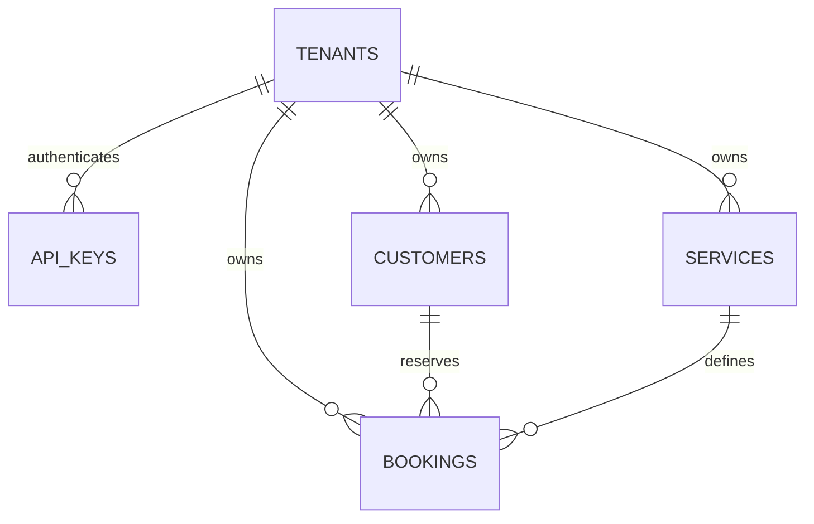

# Architecture

## Request flow

Hono installs request correlation, safe response headers and streamed body limits globally. Public health/OpenAPI endpoints perform no database operations. Versioned endpoints apply an IP limiter before authentication, then hash the Bearer credential, look up its tenant and apply a tenant limiter. Every route uses only that authenticated tenant in its queries. Zod validates strict input objects. Drizzle parameterizes values; resource table/column choices are fixed in code.

HTTP handlers live under `src/routes`; shared HTTP parsing and errors are in `src/lib`; authentication is middleware. The repository module constructs the D1 Drizzle adapter and performs credential lookup. Ordinary CRUD uses Drizzle's typed query builder directly in small handlers. Booking calculation is a pure domain service. This intentionally avoids a one-method repository abstraction for every query.



All IDs are random UUIDs. Every tenant-owned row has a tenant foreign key. Customers and services additionally have unique `(tenant_id,id)` pairs, referenced by bookings' composite foreign keys. Global UUID uniqueness is not the tenant security boundary. Emails are normalized to lowercase and unique within a tenant, including inactive rows. The hash index permits credential lookup without searching plaintext keys.

## Consistency

D1 executes individual writes atomically. `BEFORE INSERT` and `BEFORE UPDATE` triggers reject active intervals satisfying `newStart < existingEnd AND newEnd > existingStart` for the same tenant. The trigger's read executes inside the write, so another writer cannot interleave between checking and inserting. It excludes the current booking ID on updates. Cancellation changes status, freeing the slot. Adjacent bookings are allowed.

Customer and service lookups before insertion exist for scoped 404 errors and service duration calculation; they do not establish overlap safety. Trigger checks also reject inactive existing parents at write time, closing a deactivation race. Missing/foreign parents fail composite foreign keys. A concurrent service edit may leave a booking using the duration observed by the creation request; its start/end are a historical snapshot and never recomputed.

See [ADR 0001](decisions/0001-d1-atomic-bookings.md) for official sources, rejected designs and actual-runtime proof. Use primary D1 bindings (no read replication configured) so subsequent credential lookups observe revocation. Already authenticated requests may finish.

## Data lifecycle

DELETE on customers/services is idempotent deactivation, preserving referential history. Existing bookings remain active and keep their slots until explicitly cancelled. Customer deactivation is permanent through v1; service PATCH can reactivate. Cancel is idempotent and retains historical records. Cancellation can still succeed if a parent is inactive because the active-booking trigger does not apply to cancelled rows.

Only API writes are supported for ordinary users. Operators with direct D1 access are trusted and must preserve canonical UTC timestamps and schema guards. No data erasure or tenant deletion workflow is included. Operators must define retention, export, recovery and deletion policies before storing actual personal data.

## Operations

The admin CLI is out of band and local by default. It creates secure keys, sends only hashes to D1, restricts temporary SQL files and removes them on exit. It never exposes an HTTP bootstrap endpoint. Rate limits use native Workers bindings with IP and tenant prefixes. Missing `CF-Connecting-IP` locally uses a shared `local` bucket. Production requests must enter through Cloudflare, which supplies the connecting address; no user-controlled tenant header is honored.

Structured logs contain request ID, method, response status and elapsed milliseconds only. They omit paths, query values, bodies, IPs, customer data and exception messages. `Cache-Control: no-store` prevents authenticated response caching. CORS is deliberately unconfigured. The browser test console uses same-origin API requests, while external API clients use Bearer authentication. Credentials are entered at runtime and must never be embedded in browser code.

## Repository map

```text
src/
  app.ts, index.ts       Worker composition and export
  db/schema.ts          Typed Drizzle schema
  lib/                  Errors, HTTP parsing, cryptography, environment types
  middleware/auth.ts    Authentication and tenant limiter
  repositories/         D1 adapter and credential lookup
  routes/               Customer, service and booking HTTP handlers
  schemas/              Strict Zod validation
  services/booking.ts   Time calculations and overlap model
  openapi.ts            OpenAPI contract, input schemas shared with validation
migrations/             Drizzle-generated schema, custom triggers, snapshots
scripts/                Operator CLI and OpenAPI export
tests/                  Unit, integration and concurrency suites on workerd
.github/workflows/      Secret-free validation CI
docs/                   Architecture, decisions, examples, release evidence
```

## Browser test console

`frontend/` contains a dependency-free HTML/CSS/JavaScript console. Wrangler Static Assets serves the root page and its assets; explicit Worker-first routing preserves the API, health, Swagger and OpenAPI endpoints. No SPA fallback is enabled: missing assets remain 404 responses instead of returning HTML. Static asset headers include a self-only script/style/connect CSP, no-store caching and anti-framing headers.

The console uses existing authenticated routes without adding administrative or unauthenticated data endpoints. A page-memory credential is cleared on disconnect/navigation/reload; in-flight requests are aborted and stale responses cannot repopulate another tenant's view. Backend data enters the DOM using textContent and DOM nodes, never HTML interpolation. Forms support CRUD/deactivation, UTC booking creation, cancellation and pagination. Customer/service suggestions are limited to the currently loaded pages; UUIDs can always be pasted directly.
